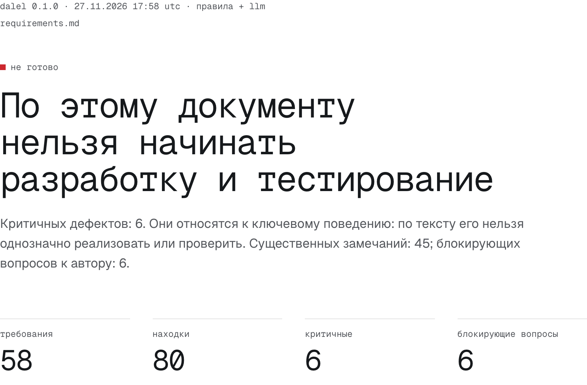
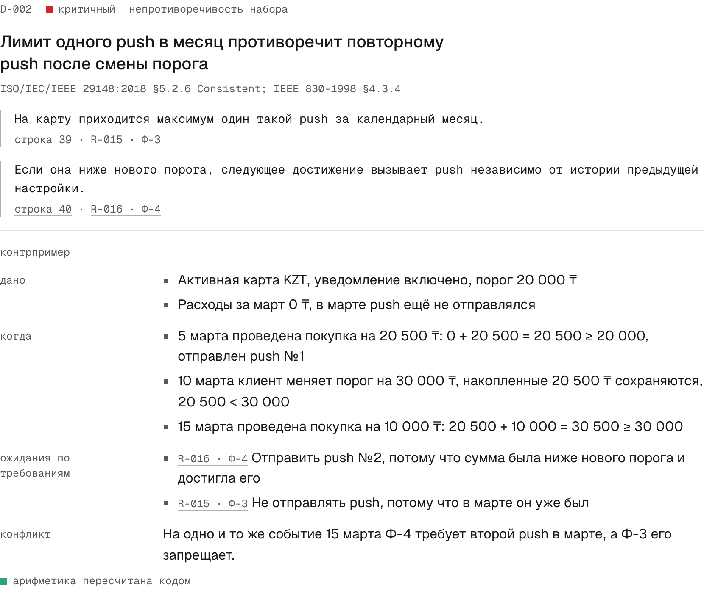
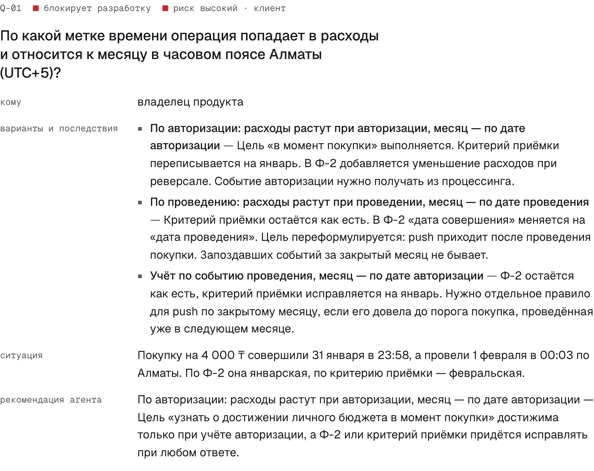
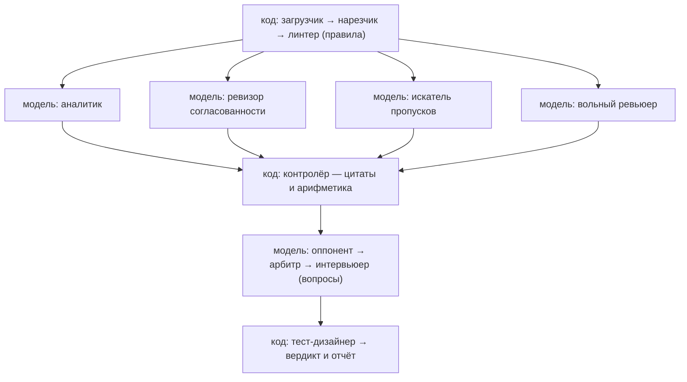
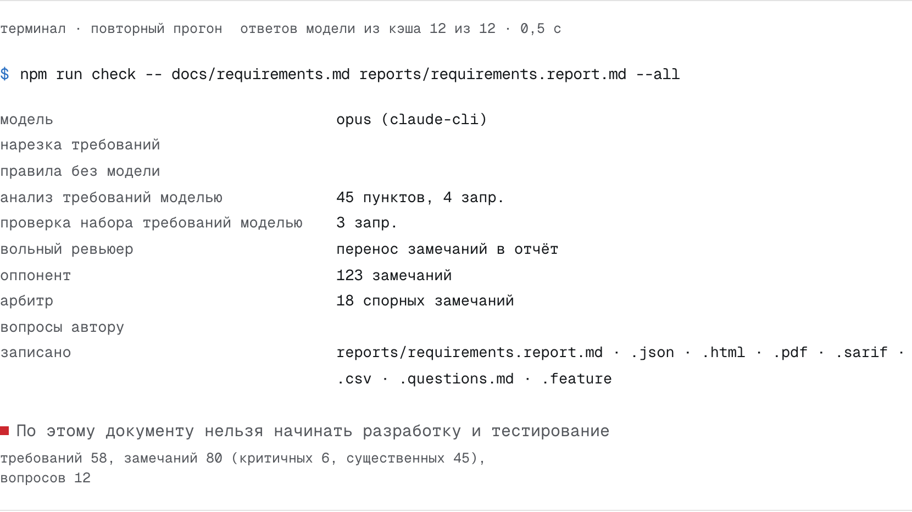

# Dalel

Агент проверяет документ с требованиями до начала разработки и пишет отчёт на русском. Каждое замечание опирается на дословную цитату и пункт ISO/IEC/IEEE 29148 или IEEE 830.

[](https://github.com/user1618phi/dalel/actions/workflows/ci.yml)  

<picture>
  <source media="(prefers-color-scheme: dark)" srcset="docs/assets/hero-dark.png">
  
</picture>

Документ хакатона: требований 58, замечаний 80 (критичных 6, существенных 45, незначительных 29), вопросов автору 12, из них блокирующих 6. Вердикт: «не готово». Отчёт: [Markdown](reports/requirements.report.md) · [PDF](reports/requirements.report.pdf) · [HTML](reports/requirements.report.html) · [в браузере](https://user1618phi.github.io/dalel/report.html).

```bash
npm ci
cp .env.example .env
npm run check -- docs/requirements.md reports/requirements.report.md
```

Нужен Node.js 22.12+. В `.env` впишите ключ одного провайдера: Gemini, OpenAI и совместимые, Anthropic, Ollama, LM Studio и vLLM, любая команда терминала или Claude Code CLI без ключа. Без ключа агент выполняет только слой правил и пишет об этом в отчёте (`--no-llm`). Все форматы, файл вопросов и тест-кейсы сразу:

```bash
npm run check -- docs/requirements.md reports/requirements.report.md --all
```

**Демо-видео (4 минуты): запуск агента, ход анализа и готовый отчёт** — [смотреть](https://drive.google.com/file/d/1sFhBe2yyPLuDCMklWPEcW5bmIcQveEUj/view)

«Дәлел» по-казахски — доказательство. Решение для BCC-HUB x MNU FinTech Hackathon.

## Что в отчёте

**Противоречие с контрпримером.** Две цитаты с номерами строк, пункт стандарта, сценарий с числами. Арифметику пересчитывает код.

<picture>
  <source media="(prefers-color-scheme: dark)" srcset="docs/assets/finding-dark.png">
  
</picture>

**Вопрос автору.** Адресат, варианты и последствия каждого, ситуация с числами из документа, рекомендация агента.

<picture>
  <source media="(prefers-color-scheme: dark)" srcset="docs/assets/question-dark.png">
  
</picture>

Ответы вписываются в [файл вопросов](reports/requirements.report.questions.md) и возвращаются агенту флагом `--answers`. Пример: после 6 демонстрационных ответов закрыто 16 замечаний, критичных осталось 1 из 6, вердикт — «не готово» ([было — стало](reports/requirements.before-after.md)).

## Как устроен

Модель предлагает, код проверяет. Двенадцать ролей: пять — код, семь — запросы к модели. Замечание без дословной цитаты из документа отбрасывается. Вердикт считает код.



<picture>
  <source media="(prefers-color-scheme: dark)" srcset="docs/assets/terminal-dark.png">
  
</picture>

Стандарты: ISO/IEC/IEEE 29148:2018 §5.2.5 (характеристики требования), §5.2.6 (характеристики набора), §5.2.7 (формулировки); IEEE 830-1998 §4.3. Подробно — [`docs/ARCHITECTURE.md`](docs/ARCHITECTURE.md).

## Измерения

| Что измерено | Результат | Чего это не доказывает |
| :--- | :--- | :--- |
| Точность: каждое замечание оценивает другая модель (claude-sonnet-5-5) | верны 45, частично 33, неверны 2 из 80; строго 56 %, мягко 98 % | судья — тоже модель: второе мнение, не эталон |
| Покрытие каталога дефектов кейса, строгая сверка по словам | существенных 25 из 32; один запрос к той же модели — 19 | каталог составлен нами |
| То же по мнению модели-судьи | существенных 26 (+5 частично) из 32; один запрос — 26 (+5 частично) из 32 | по этой мере агент и один запрос равны |
| Стабильность, 3 прогона без кэша | критичных 5 из 7 в каждом прогоне, существенных 28 из 72 | существенные замечания меняются от прогона к прогону |
| Внесённые дефекты в двух чистых ТЗ | правила 50 из 50, смысловые 5 из 8; на чистых ТЗ замечаний правил 0 | правила писались с оглядкой на этот набор |
| Повторный запуск с кэшем ответов модели | отчёт совпадает поле в поле | без кэша модель отвечает заново |
| Тесты `npm test` | 193 | — |

Приложенный отчёт сформирован моделью `claude-opus-5-5` через провайдер `claude-cli`. Путь через Gemini реализован по документации API, но с настоящим ключом не проверен. Подробности замеров — ниже и в [`docs/EVAL.md`](docs/EVAL.md).

## Установка

```bash
npm install -g github:user1618phi/dalel
dalel doctor
```

Навык для Claude Code, Cursor, Codex и других агентов формата [skills.sh](https://skills.sh) — одной из команд:

```bash
npx skills add user1618phi/dalel
dalel skill install
```

Ещё: веб-интерфейс на своей машине (`npm run serve`), GitHub Action, MCP-сервер, Docker — в блоке «Интеграции».

## Данные

Номера карт, ИИН, телефоны, почта и IBAN маскируются до отправки модели. С локальной моделью (Ollama) документ не покидает машину. Указания внутри документа не исполняются. Ключи хранятся только в `.env`, он не попадает в репозиторий.

<details>
<summary><b>Соответствие условиям задания</b></summary>

| Условие | Где выполнено |
| :--- | :--- |
| Репозиторий с агентом, кодом и зависимостями | `src/`, `packs/`, `package.json`, `package-lock.json` |
| Запуск одной командой: путь к требованиям и путь к отчёту | `npm run check -- <требования> <отчёт>` |
| README: ключ, куда положить, команда, где отчёт | начало этого файла и блок «Ключ модели» |
| Секретов в репозитории нет, есть пример конфигурации | `.env.example`, `.gitignore` |
| Вход PDF и другие форматы | PDF, DOCX, Markdown, HTML, текст — `src/load/` |
| Отчёт сформирован агентом, на русском, файлом | `reports/requirements.report.*` |
| Паспорт прогона: документ, дата, модель, версия агента | раздел 1 отчёта |
| Как агент нарезал требования | раздел 2 отчёта |
| Проверка каждого требования | раздел 3 отчёта: матрица по девяти характеристикам и карточки замечаний |
| Проверка всего набора | раздел 4 отчёта: противоречия с контрпримерами, пропуски, трассировка |
| Сводка: число требований, нарушений, критичные дефекты | раздел 6 отчёта |
| Итог: можно ли начинать и что исправить первым | начало отчёта и раздел 7 |
| Каждое нарушение ссылается на место в документе | цитата и номер строки у каждого замечания; сверяет код |
| Критерии ISO/IEC/IEEE 29148 и IEEE 830 | у каждого замечания указана характеристика и пункт стандарта |
| Уточняющие вопросы по ТЗ | раздел 5 отчёта, файл вопросов, цикл ответов |
| Агент «анализирует и тестирует ТЗ» | черновик тест-кейсов в разделе 4 отчёта и файл `.feature` |
| Повреждённые файлы | понятная диагностика и диагностический отчёт, блок ниже |
| Архитектура агентов | двенадцать ролей: пять — код, семь — модель, [`docs/ARCHITECTURE.md`](docs/ARCHITECTURE.md) |

</details>

<details>
<summary><b>Ключ модели</b></summary>

| Провайдер | Что вписать в `.env` | Где взять |
| :--- | :--- | :--- |
| Google Gemini, бесплатный тариф | `GEMINI_API_KEY`, при желании `GEMINI_MODEL` (по умолчанию `gemini-flash-latest`) | [aistudio.google.com](https://aistudio.google.com/) → «Get API key» |
| OpenAI и совместимые (OpenRouter, DeepSeek, vLLM) | `OPENAI_API_KEY`, `OPENAI_MODEL`, при необходимости `OPENAI_BASE_URL` | кабинет провайдера |
| Anthropic | `ANTHROPIC_API_KEY`, `ANTHROPIC_MODEL` | console.anthropic.com |
| Ollama, локально | `OLLAMA_BASE_URL`, `OLLAMA_MODEL` | модель на своей машине |
| LM Studio, vLLM, llama.cpp | `OPENAI_BASE_URL` на локальный сервер, `OPENAI_MODEL` | любой сервер с OpenAI-совместимым API |
| Любая команда терминала | `DALEL_PROVIDER=cli`, `DALEL_CLI_CMD="ollama run qwen2.5:14b"` | программа читает запрос из стандартного ввода и печатает ответ |
| Claude Code CLI | `DALEL_PROVIDER=claude-cli` | установленный и авторизованный `claude`, ключ не нужен |

Провайдер выбирается по первому найденному ключу или явно: `--provider gemini --model <имя>`. Формат отчёта определяется расширением: `.md`, `.pdf`, `.html`, `.json`, `.sarif`, `.csv`.

</details>

<details>
<summary><b>Что делает агент, по шагам</b></summary>

1. Читает файл и определяет формат по содержимому. Битый, пустой, зашифрованный файл или скан без текста дают сообщение с подсказкой.
2. Нарезает документ на пункты по структуре. Модель в этом не участвует, нарезка одинакова при каждом прогоне.
3. Применяет правила без модели: размытые формулировки, незаполненные места, единицы, ссылки, таблицы API, доменные пропуски финтеха.
4. Маскирует данные карт и клиентов во всём, что уходит модели.
5. Аналитик проверяет каждый пункт, ревизор ищет противоречия, искатель пропусков в два прохода примеряет линзы предметной области, вольный ревьюер пишет свободный разбор.
6. Код сверяет цитаты с документом и пересчитывает числа в контрпримерах.
7. Оппонент пытается опровергнуть каждое замечание, арбитр пересматривает снятые.
8. Интервьюер сводит замечания в коренные причины и задаёт по вопросу на каждую.
9. Тест-дизайнер выписывает граничные значения и сценарии противоречий; набор выгружается в Gherkin.
10. Код считает вердикт и пишет отчёт.

</details>

<details>
<summary><b>Вопросы, ответы и повторная проверка</b></summary>

```bash
npm run check -- docs/requirements.md reports/after-answers.md --answers reports/requirements.report.questions.md
npm run check -- docs/requirements.md reports/after-answers.md --interactive
npm run check -- docs/requirements.md reports/requirements.report.md --tests reports/requirements.report.feature
npm run dalel -- compare reports/v1.json reports/v2.json
```

Агент решает, какие замечания ответ снимает, предлагает новую формулировку и пересчитывает вердикт. Если ответ открывает новую развилку, задаёт уточняющий вопрос (до трёх кругов). Ответ привязывается к вопросу по тексту: при иной формулировке вопроса агент сообщит, а не применит ответ молча. Демонстрация: [`reports/requirements.answers-demo.md`](reports/requirements.answers-demo.md) → [`reports/requirements.after-answers.md`](reports/requirements.after-answers.md); ответов 6, открытых замечаний было 80 (критичных 6), стало 64 (критичных 1); агент задал уточняющих вопросов: 3.

</details>

<details>
<summary><b>Измерения подробно</b></summary>

**Внесённые дефекты** (`npm run eval`). В два чистых ТЗ по одному вносятся известные дефекты 24 классов.

| Показатель | Значение |
| :--- | :--- |
| Мутантов | 58 |
| Полнота слоя правил | 50 из 50 (100 %) |
| Полнота на смысловых дефектах, где нужна модель | 5 из 8 (63 %) |
| Замечаний правил на чистых ТЗ | 0 |

Правила разрабатывались с оглядкой на этот набор, поэтому цифра слоя правил — нижняя граница для похожих документов. Смысловых мутантов восемь, результат модели колеблется: в двух прогонах 8 из 8 и 5 из 8. Доля ложных срабатываний модели на чистых ТЗ этим замером не установлена.

**Каталог дефектов кейса.** Собран вручную по открытым отчётам других команд и собственному разбору. Мягкая сверка (строки цитат и ключевые слова):

| Тяжесть по каталогу | Записей в каталоге | Найдено в отчёте |
| :--- | :---: | :---: |
| Критичные | 5 | 5 (100 %) |
| Существенные | 32 | 29 (91 %) |
| Незначительные | 38 | 30 (79 %) |

Строгая сверка, только ключевые слова: критичные 5 из 5, существенные 25 из 32, незначительные 20 из 38. Тем же способом сверены открытые отчёты других участников: медиана по существенным — 15 из 32, лучший — 30 из 32. Обе сверки измеряют полноту, а не точность, и построены на нашем каталоге — [`docs/EVAL-case.md`](docs/EVAL-case.md).

**Агент против одного запроса** к той же модели (ответ в `eval/case/baseline.md`). По мнению независимой модели-судьи отчёт агента называет существенных дефектов каталога 26 (+5) из 32, а ответ одним запросом — 26 (+5) из 32 (в скобках — названо частично); критичных — 5 (+0) из 5 и 5 (+0) из 5. Конвейер добавляет проверенные цитаты, вопросы с вариантами, тест-кейсы и вердикт по правилу — [`docs/EVAL-recall.md`](docs/EVAL-recall.md).

**Точность**: из 80 замечаний верны 45, частично верны 33, неверны 2 — строгая точность 56 %, мягкая 98 %; из 6 критичных верны 5 — [`docs/EVAL-precision.md`](docs/EVAL-precision.md).

**Стабильность**: разных критичных замечаний 7, из них в каждом прогоне найдено 5; существенных — 72 и 28; нарезка и замечания правил совпали полностью. Формулировки модели от прогона к прогону меняются, поэтому существенные замечания совпадают хуже критичных — [`docs/EVAL-stability.md`](docs/EVAL-stability.md).

</details>

<details>
<summary><b>Интеграции: веб-интерфейс, Docker, GitHub Action, MCP</b></summary>

Веб-интерфейс слушает только `http://127.0.0.1:4173`:

```bash
npm run serve
```

Docker:

```bash
docker build -t dalel .
docker run --rm -v "$PWD:/work" --env-file .env dalel docs/requirements.md reports/requirements.report.md
```

GitHub Action — замечания во вкладке Code scanning:

```yaml
- uses: user1618phi/dalel@main
  with:
    path: docs/requirements.md
    fail-on: critical
  env:
    GEMINI_API_KEY: ${{ secrets.GEMINI_API_KEY }}
```

MCP-сервер, инструмент `check_requirements`:

```json
{ "mcpServers": { "dalel": { "command": "npx", "args": ["--yes", "github:user1618phi/dalel", "mcp"] } } }
```

Без установки: `npx --yes github:user1618phi/dalel …`. Отчёт `.json` имеет схему `dalel.report/1` (`src/types.ts`), `.sarif` читают GitHub, GitLab и IDE, `.csv` загружается в трекер. Навык лежит в `skills/dalel`.

</details>

<details>
<summary><b>Повреждённые и неподходящие файлы</b></summary>

Агент не падает: пишет диагностический отчёт и возвращает код 2.

| Ситуация | Что сообщает агент |
| :--- | :--- |
| Файла нет, указан каталог | файл не найден, проверить путь |
| Файл пуст | в документе нет текста |
| PDF обрезан, защищён паролем или скан без текста | что случилось и как выгрузить заново |
| DOCX не открывается | файл повреждён, сохранить заново |
| Таблица, картинка, архив | формат не поддерживается |
| Расширение не соответствует содержимому | читает по содержимому и пишет об этом |
| Кодировка windows-1251 | перекодирует и предупреждает |
| Текст, обращённый к проверяющей модели | не исполняет, показывает как находку `S-001` |

</details>

<details>
<summary><b>Ограничения</b></summary>

- Таблицы в PDF читаются как текст, нарезка PDF грубее, чем Markdown и DOCX. Сканы без текстового слоя не распознаются, диаграммы-картинки агент не видит.
- Смысловая часть зависит от модели; слой правил от неё не зависит.
- Доменный пакет один — финтех и карты.
- Номера пунктов законов и стандартов, кроме характеристик 29148 и 830, агент не цитирует.
- Словари формулировок — русский и английский; казахский — базовый набор без морфологии.
- Сколько занимает ручное ревью такого документа в банке, мы не измеряли.

</details>

<details>
<summary><b>Устройство репозитория и разработка</b></summary>

```text
src/load       загрузка файлов и диагностика
src/segment    структурная нарезка на пункты
src/rules      правила без модели; packs — пакеты правил
src/llm        провайдеры моделей, кэш, проверка JSON по схеме
src/stages     промпты, проверка цитат и арифметики, маскирование, тест-кейсы
src/report     отчёты: md, html, pdf, sarif
src/eval       мутаторы и замеры
src/mcp        MCP-сервер;  src/serve — веб-интерфейс
skills/dalel   навык для агентов-разработчиков
eval           чистые ТЗ и каталог дефектов кейса
reports        отчёт агента по выданному документу
```

```bash
npm run typecheck
npm test
npm run eval
```

</details>

Лицензия MIT.
