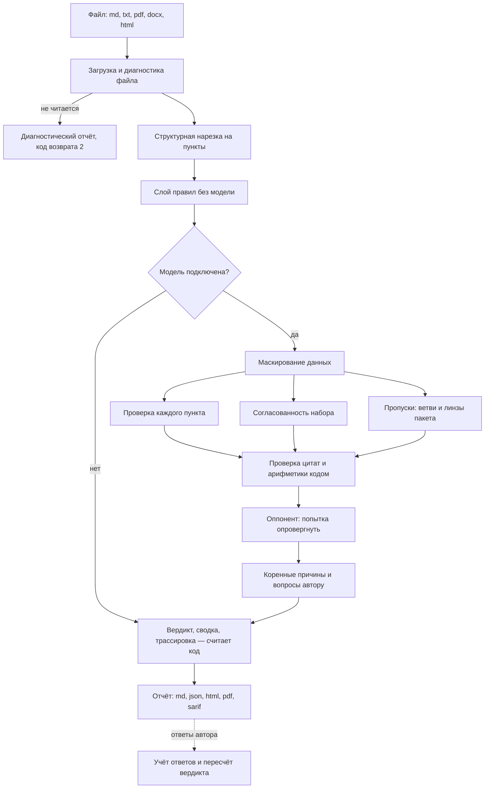

# Архитектура Dalel

Принцип один: **модель предлагает, код проверяет**. Всё, что можно установить без модели, устанавливается без неё. Всё, что утверждает модель, проходит проверку кодом или вторым, независимым проходом, прежде чем попасть в отчёт.

## Конвейер

| Этап | Кто выполняет | Что гарантирует |
| :--- | :--- | :--- |
| Загрузка | код (`src/load`) | Формат определяется по содержимому, а не по расширению. Любая проблема файла превращается в понятное сообщение с подсказкой; аварийного завершения нет. |
| Нарезка | код (`src/segment`) | Границы пунктов задаёт структура документа: пункт списка, абзац, строка таблицы, блок примера. Один и тот же текст всегда даёт одни и те же идентификаторы `R-001…`. |
| Правила | код (`src/rules`, `packs/*.yaml`) | Формулировки по §5.2.7, незаполненные места, единицы, ссылки, таблицы API, доменные пропуски. Работает без ключа и без сети. |
| Маскирование | код (`src/stages/redact.ts`) | Номера карт, ИИН, телефоны и почта заменяются символами той же длины во всём, что уходит модели. |
| Анализ | модель, три запроса разного назначения | Структурированный JSON по схеме; при несоответствии — одна попытка исправления, затем этап пропускается с предупреждением. |
| Проверка цитат | код (`src/stages/verify.ts`) | Замечание модели без дословной цитаты из документа отбрасывается. Числа в контрпримере пересчитываются; контрпример с неверной арифметикой отбрасывается. |
| Оппонент | модель, отдельный запрос с ролью защитника автора | Замечание либо устояло, либо понижено, либо отклонено с причиной. Отклонённые видны в приложении отчёта. |
| Вопросы | модель + пакет правил | Находки сведены в коренные причины; на причину — один вопрос с адресатом, вариантами, следствием каждого варианта и допущением «если не ответят». |
| Вердикт | код (`src/pipeline.ts`) | Критичный дефект есть — «нельзя начинать». Индексов «из 100» нет: число без методики ничего не доказывает. |

## Почему именно так

**Нарезка кодом.** Если границы требований выбирает модель, два прогона дают разные наборы пунктов, и отчёты нельзя сравнивать между собой. Структурная нарезка стабильна; модель только уточняет краткую формулировку.

**Цитата как условие существования замечания.** Модель видит текст с номерами строк и обязана вернуть непрерывный фрагмент. Код ищет фрагмент в документе после нормализации разметки, кавычек и тире и подставляет в отчёт текст оригинала. Не найден — замечания нет.

**Контрпример вместо мнения.** Противоречие считается показанным, когда есть сценарий с числами, в котором два места документа требуют разного результата. Это одновременно готовый тест-кейс.

**Оппонент.** Один проход склонен находить дефект в любом тексте. Второй проход получает обратную задачу — найти прочтение, при котором дефекта нет, — и снимает замечания, на которые документ уже отвечает.

**Вопрос вместо приговора.** Пропуск, зависящий от решения бизнеса, оформляется как вопрос с вариантами. Правила доменного пакета дают такие вопросы даже без модели.

**Пакеты правил как данные.** `packs/core-29148.yaml` — языковые критерии стандарта; `packs/fintech-kz.yaml` — финтех: время, деньги, события, уведомления, данные карты. Пакет состоит из словаря, правил пропусков («есть тема — нет уточнения») и линз — вопросов, которые модель примеряет к документу. Новый домен добавляется файлом, без изменения кода.

## Отказоустойчивость

- Нет ключа модели — выполняется слой правил, в паспорте отчёта стоит режим «только правила», в итоге сказано, что смысловая проверка не проводилась.
- Этап модели упал или вернул не тот JSON — остальные этапы выполняются, в диагностике отчёта появляется предупреждение с названием этапа.
- Дополнительный формат отчёта не записался — основной отчёт всё равно записан.
- Текст в документе, обращённый к проверяющей модели, не исполняется и попадает в отчёт как находка `S-001`.

## Воспроизводимость

Паспорт прогона содержит SHA-256 документа, модель, версию и коммит агента, версии пакетов правил и хэш промптов. Ответы модели кэшируются по ключу «провайдер + модель + промпт»; число обращений и попаданий в кэш показано в паспорте. Слой правил детерминирован полностью.

## Замер качества

`npm run eval` берёт чистые ТЗ из `eval/specs`, вносит в них по одному известному дефекту (29 мутаторов, 24 класса) и проверяет, что агент сообщил о мутанте то, чего не сообщал о чистом тексте. На чистых ТЗ существенных замечаний быть не должно. Замер слоя правил входит в CI. Результат — в `docs/EVAL.md`.

## Расширение

| Что добавить | Где |
| :--- | :--- |
| Доменное правило пропуска или линзу | `packs/<домен>.yaml` |
| Структурное правило | `src/rules/index.ts`, идентификатор вида `A-0NN` |
| Провайдер модели | `src/llm/index.ts`, функция `createClient` |
| Формат отчёта | `src/report/`, подключение в `src/cli.ts` |
| Мутатор для замера | `src/eval/mutators.ts` |
